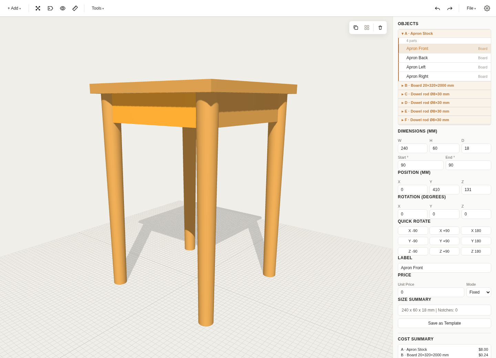
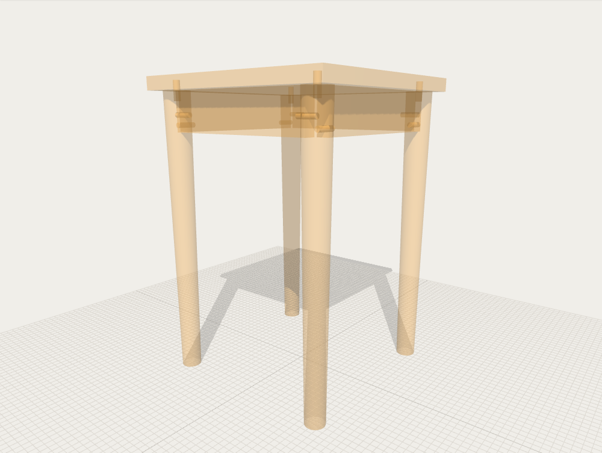
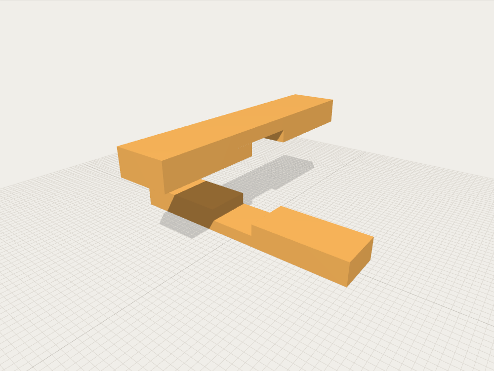
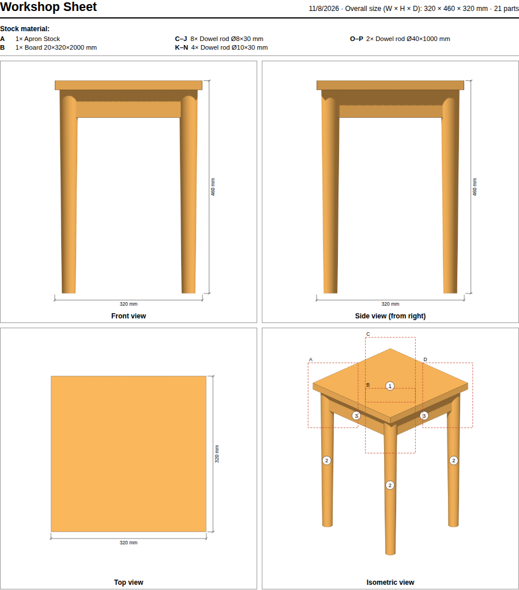
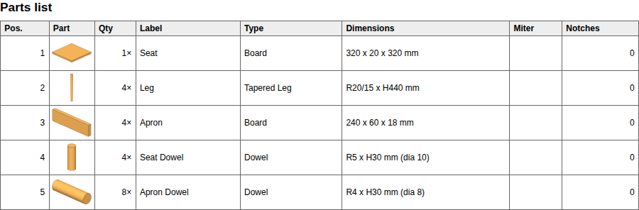
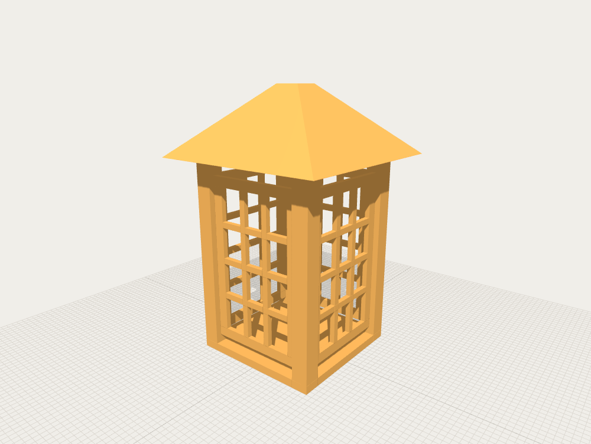

# 3D Wooden Modeler

Plan your next woodworking project in 3D, then take the dimensions, parts list and costs into the workshop. Free and open source, and it runs in your browser with nothing to install.

**[▶ Try it live](https://urfin78.github.io/3d-wooden-modeler/)**

## What you can do

### See inside your construction

X-Ray mode makes every piece transparent, so you can check where dowels sit inside legs and aprons. Show Overlaps highlights pieces that intersect by accident.

### Cut joints

Subtract one piece from another to carve notches and dowel holes. Here, two boards were cut into each other to make a cross-lap joint, and the upper board is lifted to show both notches.

### Take a plan into the workshop

File → Print Workshop Sheet creates a printable A4 sheet, or a PDF through your browser's print dialog. It has front, side, top and isometric views with overall dimensions, detail views of hidden parts, and a numbered parts list.

| Views with dimensions | Parts list |
| --- | --- |
|  |  |

### Start from a template

The `+ Add` menu has metric stock parts such as battens, planks and dowel pins, and you can save your own. Assembly templates build a whole construction from a few parameters, like this Japanese lantern.

### Plan your material and costs

- **Split with saw kerf:** divide a board or dowel into parts, with the material lost to each cut accounted for.
- **Know the price:** set a fixed or per-mm price for each piece and watch the total update.
- **Export a cut list:** download dimensions, notch counts and costs as CSV.

## Get started

1. Open the [live app](https://urfin78.github.io/3d-wooden-modeler/), or download `index.html` and open it in a modern browser. It needs an internet connection to load Three.js.
2. Add pieces with `+ Add`.
3. Click a piece to edit its dimensions, position and rotation in the side panel, or drag it in the 3D view.
4. Save your project from the **File** menu. Less frequent actions such as Cut Joint and Split are in the **Tools** menu.

To explore a finished model, download [`examples/stool.woodmodel.json`](examples/stool.woodmodel.json) and open it with **Load** in the **File** menu. It is a four-legged stool with tapered legs, aprons and dowels. Turn on X-Ray to see the dowels inside.

## All features

<strong>Shapes and editing</strong>

- 8 shape types: Board, Frustum Board (trapezoidal), Pyramid Frustum (4-sided), Frame (outer frame with grid bars, for window frames, shoji or lattice), Dowel, Wedge, L-Bracket and Tapered Leg
- Edit dimensions, position, rotation and label in the side panel
- Optional miter angles on each board end face, for picture frames or rafter tops
- Snap mode with face contact, edge alignment and dowel axis snapping; falls back to a 10 mm grid
- Duplicate pieces
- Group several pieces so they move and snap as a unit; groups persist in save files
- Split a board or dowel by number of parts or by target length, with configurable saw kerf; split parts stay grouped in the object list and count as one purchase in the costs
- Cut joints with CSG boolean subtraction
- Undo and redo

<strong>View and measure</strong>

- 3D view with orbit, pan and zoom
- X-Ray mode, 3D labels and overlap detection
- Two-click ruler with total distance and per-axis components; rulers can be deleted one at a time or all at once
- Auto-resizing grid that adapts to your model

<strong>Templates</strong>

- Built-in metric woodworking parts
- Custom templates stored in your browser, with JSON export and import
- Assembly templates that create a pre-grouped construction from a few parameters

<strong>Costs and output</strong>

- Fixed or per-mm prices, currency selector and live cost summary
- Save and load projects as `.woodmodel.json`
- Workshop sheet for printing or PDF; identical parts are merged into one numbered row of the parts list
- CSV cut list with dimensions, types, notch counts and costs
- PNG export of the current view

The UI is available in English and German. The language is detected from your browser and can be changed in the Settings menu. All dimensions are in millimeters.

## Controls

| Action | Input |
| --- | --- |
| Move a piece | Drag |
| Move a piece vertically | Shift+drag |
| Select several pieces | Ctrl+click |
| Duplicate | Ctrl+D |
| Undo / redo | Ctrl+Z / Ctrl+Shift+Z |
| Set the orbit pivot | Double-click a piece |
| Recenter on the model | Double-click empty space |
| Focus the selection | F |
| Cancel a ruler measurement | Esc |

## Your data

Projects are saved as files on your computer, and custom templates stay in your browser's local storage.

## Development

    

This project was fully created using [Claude Code](https://claude.ai/claude-code) by Anthropic.

The app is a single `index.html` with no build step, no framework and no local toolchain.

- [Three.js](https://threejs.org/) 0.187.0, loaded as an ES module via CDN and pinned with SRI hashes
- Inline CSG (Constructive Solid Geometry) implementation based on the Evan Wallace csg.js algorithm

### CI

Five GitHub Actions workflows run on every push to `main` and on pull requests:

- **Schema validation** — example files in `examples/` are validated against `woodmodel.schema.json` and `woodtemplates.schema.json` (`ajv-cli`).
- **JS syntax** — the inline module script in `index.html` is extracted and parsed with `node --check` so unbalanced brackets, stray commas, or broken string literals fail before they ever reach a browser.
- **Playwright smoke** — headless Chromium drives the app through a small set of smoke tests (every primitive can be added; CSG cut survives save/reload; language switch updates UI strings). The tests under `tests/` reach into the app via `window.__app`, a hook attached only when the page is loaded with `?__test=1`.
- **Consistency lint** — `.github/scripts/consistency-lint.mjs` parses `index.html`, `woodmodel.schema.json`, and `woodtemplates.schema.json` and verifies that translation keys are symmetric across all `SUPPORTED_LANGS`, that every `ADD_TYPES` entry has a matching `type.<Name>` translation, that every `nameKey` referenced in built-in templates and assemblies resolves in every language, that every static `data-i18n*` attribute resolves, and that every JSON-schema `type` enum (piece and CSG tool in `woodmodel.schema.json`, plus `woodtemplates.schema.json`) equals `ADD_TYPES` as a set.
- **Visual regression** — Playwright takes a canvas screenshot per default `ADD_TYPES` primitive plus one CSG-cut composition (`tests/visual.spec.js`) and compares against PNG baselines under `tests/visual.spec.js-snapshots/`. Baselines are regenerated via the manual **Update visual baselines** workflow (`workflow_dispatch`), which runs `playwright test --update-snapshots` and opens a PR with the new PNGs for review.

The README screenshots under `docs/screenshots/` are regenerated via the manual **Update README screenshots** workflow (`workflow_dispatch`), which runs `tests/readme-screenshots.spec.js` and opens a PR with the new PNGs.

Releases are cut by the manual **Auto Release** workflow (`workflow_dispatch`). It derives the version bump from commit subject lines since the last tag (`feat:` for minor, `type!:` or `BREAKING CHANGE` in the subject for major, anything else for patch), creates a GitHub Release, and deploys `index.html` to the `gh-pages` branch.

The CI tooling lives under [`.github/package.json`](.github/package.json) — kept inside `.github/` so it stays out of the application code. The app itself has no build dependencies.

## License

This project is licensed under the [MIT License](LICENSE).
